# Pitchary

Pitchary ist ein lokales CRM für Kunden, Angebote und Rechnungen.

## Funktionen

- Leads, Kunden und Ansprechpartner verwalten.
- Personen über ein eigenes Menü nach Name, Unternehmen, Position oder E-Mail suchen und ihre Kontaktdaten, Angebote und Aktivitäten öffnen.
- Dienstleistungen und Preise hinterlegen.
- Angebote vom ersten Pitch bis zum Abschluss verfolgen, Kontakte und Preisverhandlungen protokollieren.
- PDF-Rechnungen importieren, per OCR oder optional mit KI auslesen und den Zahlungsstatus verwalten.
- Umsatz, Ausgaben und Abschlussquoten auswerten.
- Alle Hauptansichten direkt über das Dock-Kontextmenü öffnen.

## Installation

Für Macs mit Apple Silicon, ab macOS 26.4.

### Homebrew

```sh
brew install --cask oliverjessner/tap/pitchary
```

### DMG

Die DMG aus dem [aktuellen Release](https://github.com/oliverjessner/pitchary/releases/latest) herunterladen, öffnen und **Pitchary** in den Ordner **Programme** ziehen.

Die App ist derzeit nicht notarisiert. Falls macOS den ersten Start blockiert, unter **Systemeinstellungen → Datenschutz & Sicherheit → Dennoch öffnen** freigeben.

## Screenshots

`npm run screenshots` erzeugt alle Menüansichten mit Demodaten neu (1920 px breit).

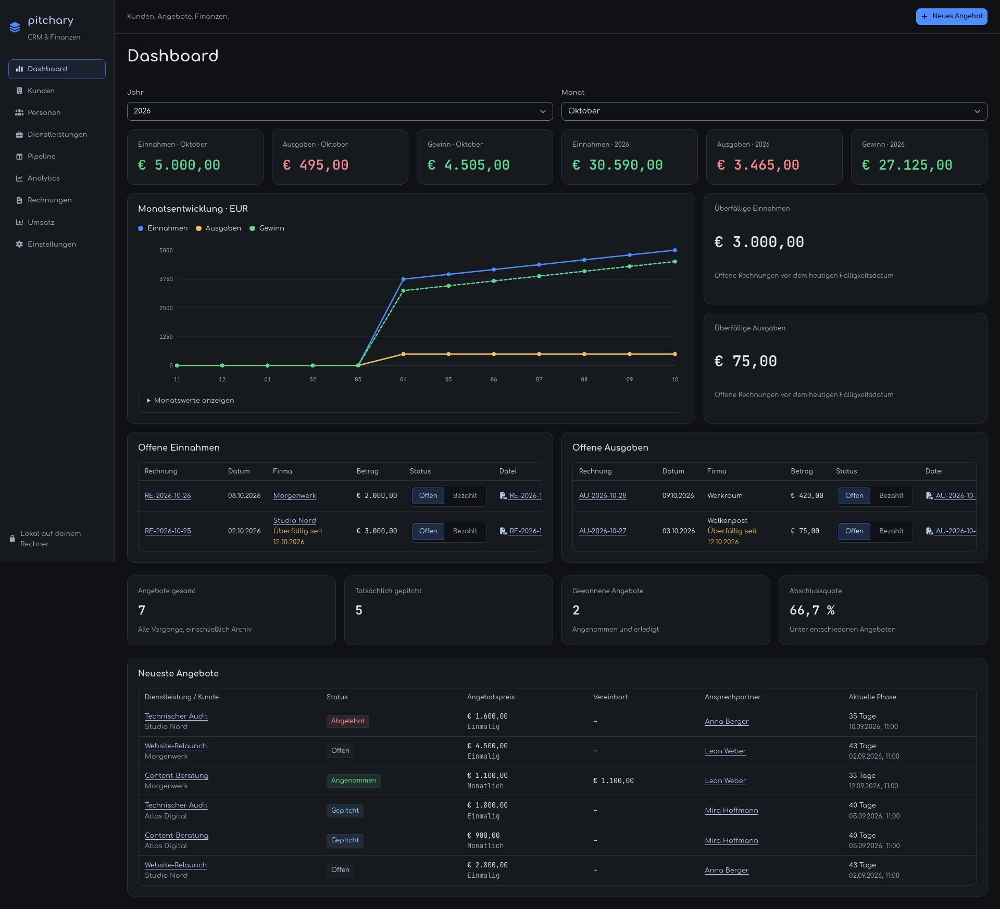

| Kunden                                                                       | Dienstleistungen                                        |
| ---------------------------------------------------------------------------- | ------------------------------------------------------- |
| 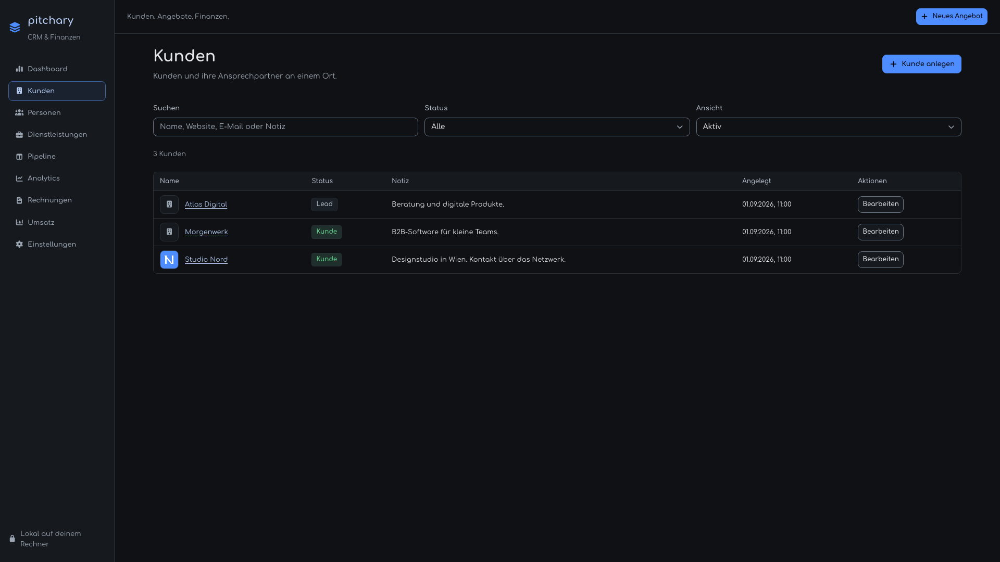 | 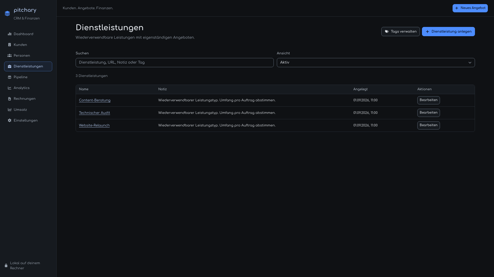 |

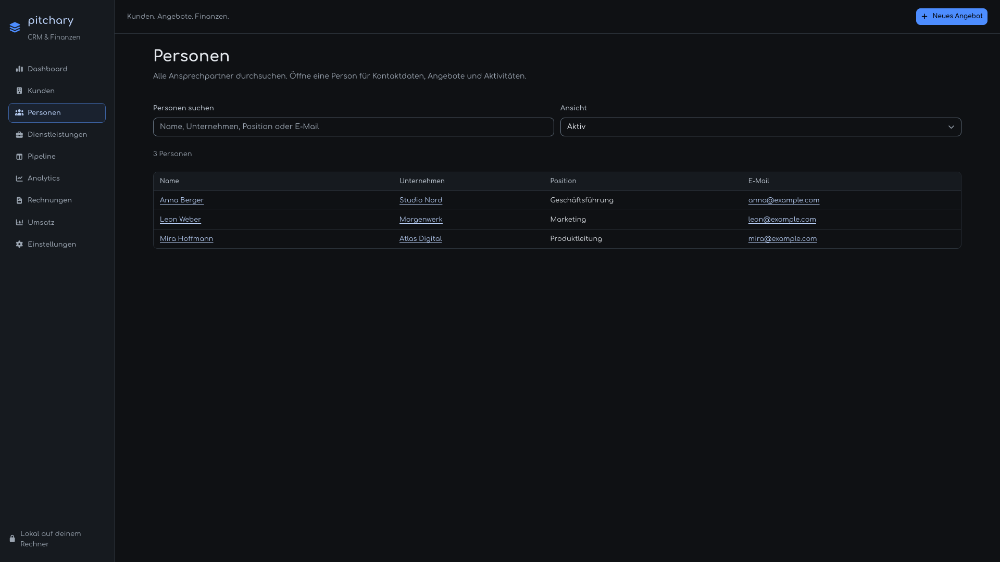

| Pipeline                                                                          | Analytics                                                                                |
| --------------------------------------------------------------------------------- | ---------------------------------------------------------------------------------------- |
| 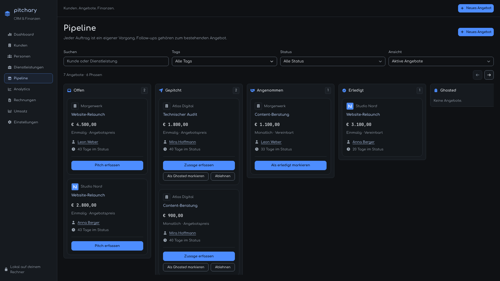 | 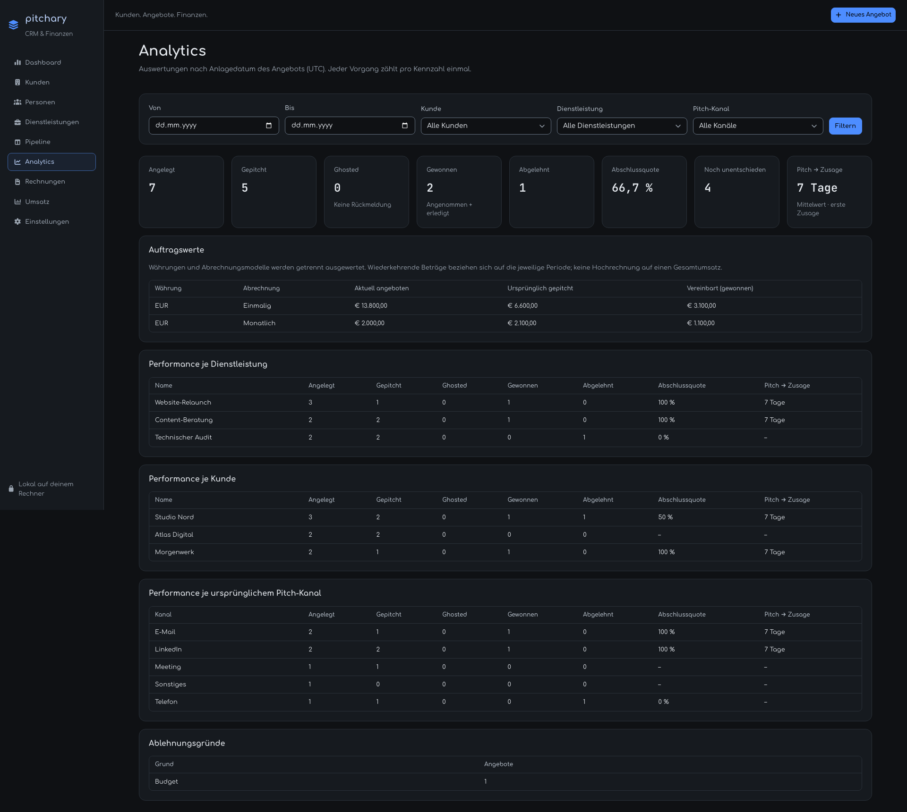 |

| Rechnungen: Einnahmen                                                         | Rechnungen: Ausgaben                                                                 |
| ----------------------------------------------------------------------------- | ------------------------------------------------------------------------------------ |
|  | 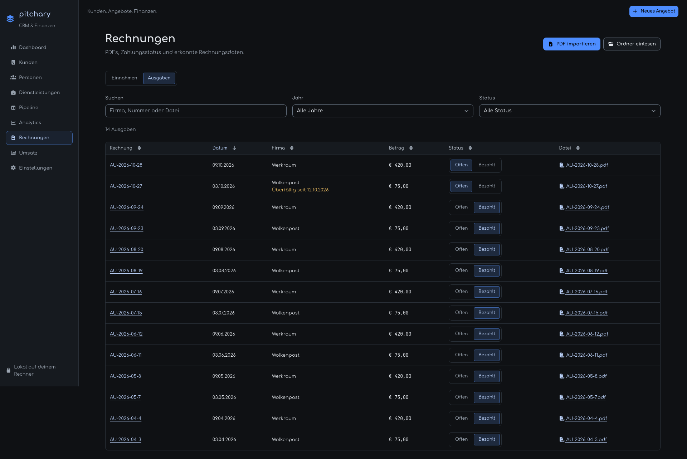 |

| Umsatz                                                                      | Einstellungen: Firma                                               |
| --------------------------------------------------------------------------- | ------------------------------------------------------------------ |
| 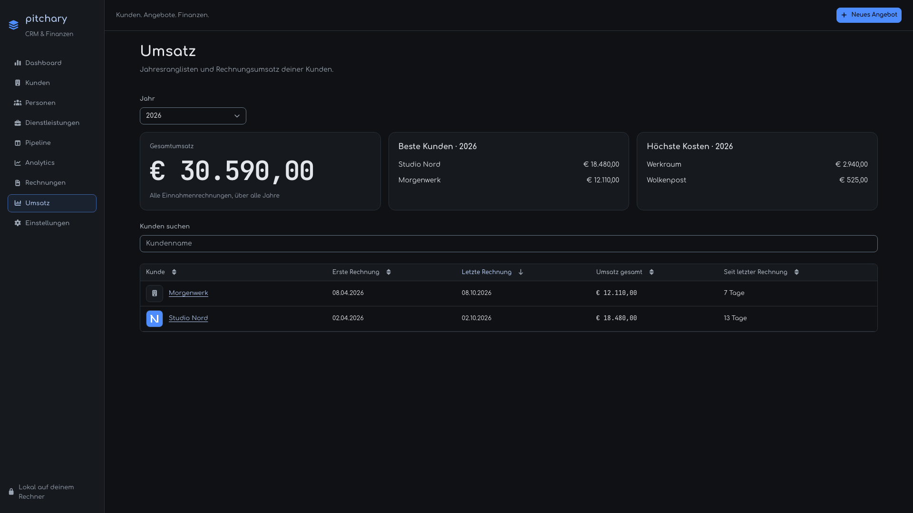 | 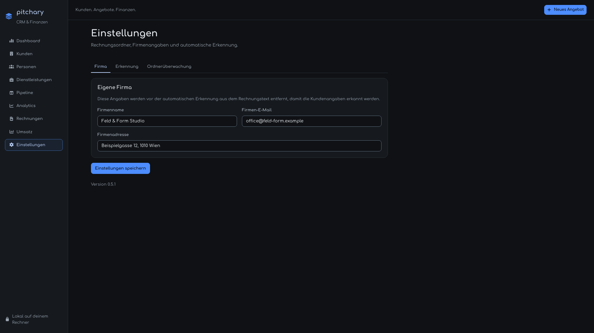 |

| Einstellungen: Erkennung                                                                        | Einstellungen: Ordnerüberwachung                                                           |
| ----------------------------------------------------------------------------------------------- | ------------------------------------------------------------------------------------------ |
| 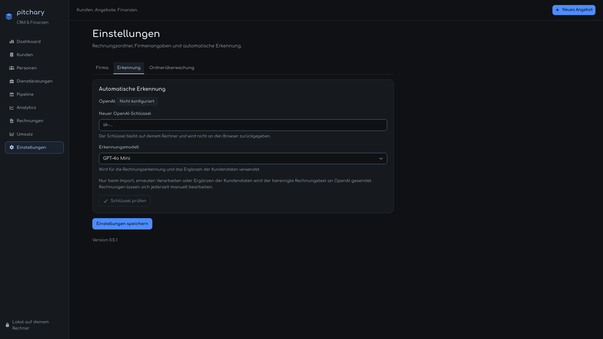 | 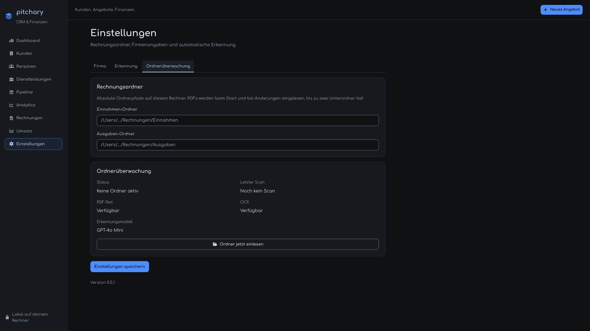 |
